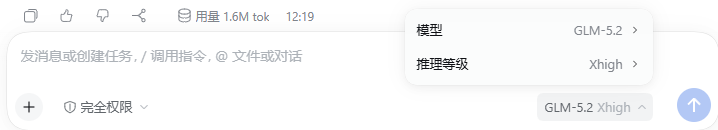

<div align="center">

# api_thinking

**自动读取第三方 API 的模型清单，把每个模型真实支持的思考档位同步进 DSH**

[English](README.md) · [MIT](LICENSE)

[](https://www.npmjs.com/package/dsh-api-thinking)
[](https://www.npmjs.com/package/dsh-api-thinking)
[](LICENSE)
[](https://github.com/shuang-ying/dsh-ThirdApi-ThinkingMode/actions/workflows/test.yml)

</div>

> api_thinking 是社区维护的 DeepSeek Harness（DSH）插件，并非 DeepSeek AI 官方产品。

## 它解决什么问题

DSH 内置的模型目录不包含你的第三方 API。为了让它们出现在模型选择器里，你需要手写一条 `llm-pi-ai` 路由，并在其中列出 `models:`。

但**手写 `models:` 会整体替换内置目录**。这些模型既不在目录中，也没有声明 `reasoningEfforts`，`dsh-llm-pi-ai` 于是把它们判定为「不支持推理」，**模型选择器里不会出现思考强度**。

手工把档位写进 YAML 能解决一次，但会立刻过期：网关上线了新模型没人补，上游调整了支持范围也没人改。

而 OpenAI 兼容网关**自己的模型清单里通常已经带着这项能力**。本插件读它，把结果写回配置——你不再需要维护那份 YAML。

## 功能概览

- **自动同步思考档位**：请求每条路由的模型清单，把端点公布的档位写进对应模型条目的 `reasoningEfforts`。
- **新增 API 即刻生效**：新加一条路由、或给已有路由增加模型之后，无需修改插件、无需重启。
- **不无中生有**：端点没有提及推理能力时保持原样，不会抹掉你手写的档位。
- **只掌管一个字段**：只拥有 `reasoningEfforts`，注释、`!!js` 表达式和其他字段一律保持原样。
- **幂等**：实际内容没有变化时不写文件。
- **自带诊断**：每次加载与扫描都会写入状态文档，出问题时有据可查。

## 界面预览



*装好之后，模型选择器会显示该模型真实支持的思考档位。*

## 安装

需要已安装并能正常运行 DeepSeek Harness。以下示例使用 `desktop` profile，请按实际环境替换 profile 名。

### 在插件页安装

打开 DSH 网页界面的「设置 → 插件」，搜索 `dsh-api-thinking` 并安装。也可以让 Agent 直接调用插件管理器的 `install_bundle`。

### 命令行安装

```bash
dsh plugin --profile desktop add dsh-api-thinking
```

安装后重启 DSH 并刷新页面。

### 让 Agent 帮你安装

把下面这段话发给能够操作终端、并且已经连接 DSH 的 Agent：

```text
请把 dsh-api-thinking 安装到我的 DSH profile，装完确认它已生效，并告诉我如何重新加载。
```

### 卸载

在插件页关闭或卸载；也可以从该 profile 的 `package.json` 中移除 `dsh-api-thinking` 依赖，并同时从 `dsh.profile.bundles` 数组里删掉它。

## 使用说明

装好即用，**没有需要手动开启的开关**。插件会遍历 `llm-pi-ai` 这一行下的每条路由：

| 你想做什么 | 如何操作 |
| --- | --- |
| 让某个模型显示思考档位 | 在「设置 → 模型」里配置好路由和模型，稍等片刻即可 |
| 新增一个 API | 直接在模型页添加，档位会自动跟上 |
| 缩小扫描范围 | 用 `routes` 指定路由名；默认扫描所有 OpenAI 兼容路由 |
| 调整扫描频率 | 修改 `intervalMs`；设为 `0` 表示只在加载后扫描一次 |
| 排查「为什么没有生效」 | 读状态文档，见[排查](#排查为什么没有生效) |

## 判定规则

每个模型的能力来自端点模型清单里**第一个命中**的字段：

| 用途 | 字段（按优先级） |
| --- | --- |
| 可选的思考档位 | `reasoning_supported_efforts` → `supported_efforts` → `reasoning_efforts` |
| 能否关闭思考 | `can_disable_thinking` → `reasoning_can_disable` |
| 是否为推理模型 | `supports_reasoning` → `reasoning` |
| 钉死的档位 | `reasoning_effort` → `fixed_effort` → `effort` |

读完之后按下面的规则写入：

| 端点说 | 写入的 `reasoningEfforts` |
| --- | --- |
| 公布了可选档位 | `{ low: low, high: high, ... }`，只保留 DSH 能命名的档位（`off` / `minimal` / `low` / `medium` / `high` / `xhigh` / `max`），按升高顺序 |
| 没公布集合，但钉死了一个档位 | 写入**那一个**档位——选择器显示它实际运行的档位（选中是同值，行为不变）。可用 `fixedEffortAsLevel: false` 关闭 |
| 明确 `supports_reasoning: false` | `false` |
| 说了有推理，但既没有集合也没有钉死档位 | **删除该键**（写 `false` 等于谎称它不推理） |
| **对推理完全沉默** | **保持不动** |
| **清单里没有这个模型** | **保持不动** |

最后两条是刻意的安全设计：LiteLLM、vLLM 和多数自建网关不公布任何能力数据，若把「沉默」当作「没有档位」，插件会把用户手写的配置全部抹掉。**插件只在端点明确谈论推理时才动手。**

`includeOff` 默认关闭。pi-ai 在「未选择任何档位」时会把映射表里的 `off` 值作为默认值发出，所以给可关闭思考的模型加上 `off`，会让「提供方默认」实际等于「不思考」——必须由你显式打开。

## 配置项

```yaml
- insert:
    - id: api-thinking
      name: dsh-api-thinking
      config:
        entryId: llm-pi-ai
        routes: []
        intervalMs: 120000
        startDelayMs: 3000
        timeoutMs: 15000
        includeOff: false
        fixedEffortAsLevel: true
        log: true
        statusFile: ''
```

| 配置项 | 默认值 | 说明 |
| --- | --- | --- |
| `entryId` | `llm-pi-ai` | 读写的 profile 行 |
| `routes` | `[]` | 要处理的路由名；`[]` 表示所有 OpenAI 兼容路由 |
| `intervalMs` | `120000` | 周期扫描间隔（毫秒）；`0` 表示只在加载后扫描一次 |
| `startDelayMs` | `3000` | 首次扫描延迟，等待 profile 加载完成 |
| `timeoutMs` | `15000` | 单个端点模型清单请求的超时 |
| `includeOff` | `false` | 是否把 `off` 作为可选档位暴露（注意上文副作用） |
| `fixedEffortAsLevel` | `true` | 端点钉死档位时，是否把它显示为唯一档位 |
| `log` | `true` | 是否记录每次改动与被跳过的路由 |
| `statusFile` | `''` | 状态文档路径；`''` 表示 `$DSH_HOME/api-thinking.status.json`，`false` 表示不写 |

> **覆盖 bundle 行**：profile patch 里的覆盖行必须与 bundle 层的 `name` 逐字一致（`dsh-api-thinking`），否则 `applyEntryPatches` 会静默跳过该行。

## 触发时机

| 触发 | 时机 | 覆盖的场景 |
| --- | --- | --- |
| `start` | 插件加载后 `startDelayMs`（默认 3 秒） | 启动或重载时的全量校准 |
| `config-change` | profile patch 被修改后（经 HMR 配置监听，2 秒防抖） | 新增或修改 API、路由、模型 |
| `interval` | 每 `intervalMs`（默认 120 秒） | 兜底：上游网关侧的模型与能力变化 |

每次扫描都会从 profile 层**重新组合读取**该行的 `providers`，而不是读插件实例化时的快照——这正是「刚保存的路由立刻被看见」的原因。

## 排查：为什么没有生效

宿主日志在插件里不保证可达，因此每次加载与扫描都会把结果写进状态文档（默认 `$DSH_HOME/api-thinking.status.json`）：

```json
{
  "phase": "sweep", "reason": "interval", "wrote": true, "via": "patch-file", "error": null,
  "routes": [{ "route": "my-gateway", "models": 20, "listed": 51,
               "changes": [{ "id": "example-model", "to": { "low": "low", "high": "high" } }],
               "dropped": [], "error": null }]
}
```

排查时先看这几个字段：

| 字段 | 含义 |
| --- | --- |
| `phase` | 当前阶段（`apply` / `sweep`） |
| `error` | 失败原因，例如界面看不到的请求错误 |
| `listed` | 端点返回了多少个模型 |
| `models` | 该路由配置了多少个模型 |
| `changes` | 本次计划修改哪些模型 |
| `wrote` / `via` | 是否写入，以及走的是哪条写通道 |

`listed` 有值而 `changes` 为空，通常说明端点没有公布推理能力——见[判定规则](#判定规则)。

## 写入通道

插件优先走官方通道，只在必要时回退：

| 通道 | 何时使用 | 说明 |
| --- | --- | --- |
| `config-editor` | 正常情况 | `ctx.configEditor.edit()`，官方路径，带文件锁、schema 校验与 Loader 对账 |
| `patch-file` | 官方通道报 `HMR transactions cannot be nested` 时 | 直接改写 profile patch，由同一个配置监听重组 |

回退通道与安装方式无关：**被热重载**时，插件的 `apply()` 运行在替换它的那次 HMR 事务内，此后每次通过官方通道写入都会被判为嵌套事务。回退通道只改动目标模型的 `reasoningEfforts`（按缩进定位，写入临时文件后 rename），注释和其他字段保持逐字节不变。

## 已知限制

- 只读取**模型清单**这一种能力来源。端点不公布推理能力时插件无能为力，会保持不动。
- 只支持能够列出模型的协议：`openai-completions`、`openai-responses`、`anthropic-messages`。
- 逐模型精确匹配 id，不做别名或模糊匹配。
- `off` 的默认语义受 pi-ai 适配器限制，无法表达「可选但非默认」。
- 回退通道不做 schema 校验，只做结构定位。
- 与设置页同时写入 `cordis.patch.yml` 时理论上可能互相覆盖；下一次扫描会重新收敛（幂等）。

## 反馈与贡献

遇到问题或有建议，欢迎[提交 Issue](https://github.com/shuang-ying/dsh-ThirdApi-ThinkingMode/issues)，并附上 DSH 版本、插件版本和复现步骤。

```bash
npm test                              # 15 项检查：纯逻辑、patch 改写、组合读取、真实网关目录交叉验证
node tools/check_live.mjs             # 线上 profile 与网关逐模型比对，drift 应为 0
node tools/diff_gateway_profile.mjs   # 「为什么新 API 没出现」：网关与 profile 的逐模型差异
```

维护工具从环境推断位置（`DSH_HOME` / `DSH_PROFILE`，或 `API_THINKING_PROFILE_DIR`、`API_THINKING_PROFILE`），并从 `API_THINKING_BASE_URL`（可加 `API_THINKING_API_KEY`）或 `API_THINKING_GATEWAY_CONFIG`（一个含 `{ listen, api_key }` 的 config.json）读取网关信息。

## 许可证

[MIT](LICENSE)
